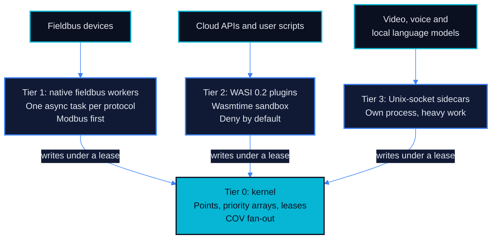

<!-- markdownlint-disable MD013 MD033 MD041 -->

<div align="center">

  

  <!-- README-STANDARD badge block: one group, fixed order -->
  <!-- 1 release/version -->
  [](docs/plan/phases.md)
  <!-- 2 CI/build -->
  [](https://github.com/lusoris/rhizomorph/actions/workflows/reuse.yml)
  [](https://github.com/lusoris/rhizomorph/actions/workflows/pages.yml)
  <!-- 3 security/scorecard -->
  [](SECURITY.md)
  [](.coderabbit.yaml)
  [](.github/rulesets/main.json)
  <!-- 4 standards -->
  [](AGENTS.md)
  [](CONTRIBUTING.md)
  <!-- 5 licence -->
  [](LICENSE)
  <!-- 6 support -->
  [](https://github.com/sponsors/lusoris)

  **Local-first smart-home and building-automation engine: a Rust core with a SvelteKit interface.**

  *Design stage: no engine code and no release yet; code follows the phase plan, starting with P1.*

</div>

rhizomorph is a local-first smart-home and building-automation engine with a
Rust core and a SvelteKit interface. It is at the design stage: there is no
engine code and no release yet; code follows the
[phase plan](docs/plan/phases.md), starting with P1. The
[concept](docs/concept.md) and the [decision records](docs/adr/README.md),
each with its status, are under [`docs/`](docs/). The design input is by the
operator; the documents in this repository are written from it.

<a id="name"></a>

A **rhizomorph** is a root-like cord of bundled fungal hyphae. A fungus grows
these cords to carry nutrients over long distances and to explore for new
food away from the place it already feeds on.

- **Origin:** Greek *rhiza* (root) and *morphe* (form): "root-form".
- **Pronunciation:** RY-zo-morf.
- **The honey fungus:** *Armillaria*, the honey fungus, spreads from tree to
  tree through the soil along its rhizomorphs. One *Armillaria ostoyae* in
  Oregon covers more than 8.8 square kilometres.
- **Why this name:** an analogy, not a claim: like a fungal network, the
  engine grows by adding small isolated parts and falls back to another path
  when one fails. [`docs/fungal-mapping.md`](docs/fungal-mapping.md) lists
  each part of the analogy and which ones have no component yet.

Source for the biology: the Wikipedia articles "Mycelial cord" and
"Armillaria", read 2026-11-18.

**[Documentation](https://lusoris.github.io/rhizomorph/)** · [Documentation source](docs/)

## Why rhizomorph

<a id="what-it-is-meant-to-become"></a>

A home and building controller that runs on your own hardware and keeps
working without a cloud account. It is meant as an alternative to existing
home-automation hubs, built to avoid three structural faults:

| Fault in a typical hub | Intended answer |
| :--- | :--- |
| Every integration shares one process, so one fault stops all of them | Isolated tiers: a small kernel, native fieldbus workers, sandboxed plugins, sidecars |
| The last writer to an output wins, whatever its importance | A priority array per commandable output with leases, as building automation uses |
| Each device driver is written by hand | Drivers generated from typed interface contracts |

These are goals, not shipped behaviour. The first two have decision records
under [`docs/adr/`](docs/adr/README.md) (ADR-0001, ADR-0002) and phases in
the plan. The third has neither yet: only plugin generation from OpenAPI
definitions is named, as a later, unverified node in ADR-0003. Each goal
gets a decision record before any code implements it.

## Get started

1. Read [Name](#name) for what the project is called and why.
2. Read [What it is meant to become](#what-it-is-meant-to-become) for the
   goal and the three faults it sets out to avoid.
3. Read [`docs/concept.md`](docs/concept.md) for the design, then
   [`docs/plan/phases.md`](docs/plan/phases.md) for the order of work.
4. To contribute, read [`CONTRIBUTING.md`](CONTRIBUTING.md), then run the
   repository gate once:

   ```bash
   make verify-all
   ```

   The steps of that gate are in [`Makefile`](Makefile).

## At a glance



The tiers are proposed in [ADR-0001](docs/adr/0001-tier-model.md) and the
leases in [ADR-0002](docs/adr/0002-priority-array-and-leases.md); neither
decision is accepted yet.

## Guides and reference

<a id="documentation"></a>

- [`docs/concept.md`](docs/concept.md): what rhizomorph is, the research behind
  it, prior art and what is still unverified.
- [`docs/adr/`](docs/adr/README.md): decision records, from the tier model to
  the hardware repository.
- [`docs/plan/phases.md`](docs/plan/phases.md): the phase plan, with exit
  checks.
- [`docs/plan/hardware.md`](docs/plan/hardware.md): the hardware plan, stages
  H0 to H3 with entry conditions and exit checks.
- [`docs/plan/coverage-matrix.md`](docs/plan/coverage-matrix.md): device
  classes across building types, the protocol each needs, and every gap with
  its source.
- [`docs/plan/design-defects.md`](docs/plan/design-defects.md): known defects
  of the design reference code and their fixes.
- [`docs/fungal-mapping.md`](docs/fungal-mapping.md): how the name maps to
  components, as analogy.

### Repository layout

| Path | Purpose |
| :--- | :--- |
| [`AGENTS.md`](AGENTS.md) | The one canonical rule file for coding agents; the per-client files are compiled from it |
| [`.standards.yaml`](.standards.yaml) | Declared governance policy of this repository |
| [`Makefile`](Makefile) | `make verify-all`, the repository gate |
| [`lefthook.yml`](lefthook.yml) | Local pre-commit and pre-push checks |
| [`.github/rulesets/main.json`](.github/rulesets/main.json) | Protection of the `main` branch, as applied on the forge |
| [`docs/adr/`](docs/adr/README.md) | Decision records |
| [`REUSE.toml`](REUSE.toml), [`LICENSES/`](LICENSES/) | Licence of every file |
| [`mkdocs.yml`](mkdocs.yml) | Documentation site configuration and navigation |
| [`.github/workflows/pages.yml`](.github/workflows/pages.yml) | Documentation build and deployment workflow |

## Contribute

Read [`CONTRIBUTING.md`](CONTRIBUTING.md) for the rules every change follows,
including Conventional Commits. Every change passes the repository gate before
it is submitted:

```bash
make verify-all
```

## Support

Support the project through
[GitHub Sponsors](https://github.com/sponsors/lusoris).
Sponsorship buys no support and no priority. Report vulnerabilities as
[SECURITY.md](SECURITY.md) describes.

## Roadmap and releases

There is no release yet. The [phase plan](docs/plan/phases.md) describes the
order of work and exit checks. The [hardware plan](docs/plan/hardware.md)
covers stages H0 to H3, their entry conditions and exit checks.

## Upstream and licence

[EUPL-1.2](LICENSE) licenses this repository. Every file states its licence in
a header or through [REUSE.toml](REUSE.toml); `reuse lint` checks that.
First-party H2 carrier board designs and H3 enclosure models use
CERN-OHL-W-2.0 ([ADR-0008](docs/adr/0008-hardware-licence.md)) and are planned
for a separate hardware repository, to be created at the start of H2
([ADR-0009](docs/adr/0009-hardware-repository.md)).

[Praetor](https://github.com/cordanaLLM/praetor) is the governance engine that
wrote the agent rules, hooks and gate in this repository.

## Standards and governance

[AGENTS.md](AGENTS.md) declares this repository's governance standards.

<!-- praetor:readme-governance:start -->
Praetor manages this repository's declared governance policy. This managed
block records adoption state; it is not a verification certificate.

**Verification**: `make verify-all` runs the repository's configured
verification cascade.

**HISS Audit**: `praetorctl audit` enforces policy, generated-surface
integrity, and the debt ratchet.

**Context Sync**: `praetorctl compile-context --verify` verifies every
generated agent context against `AGENTS.md`.

**Debt Baseline**: `.standards-baseline.json` anchors the debt ratchet at
0 recorded infractions; audit forbids growth.
<!-- praetor:readme-governance:end -->
