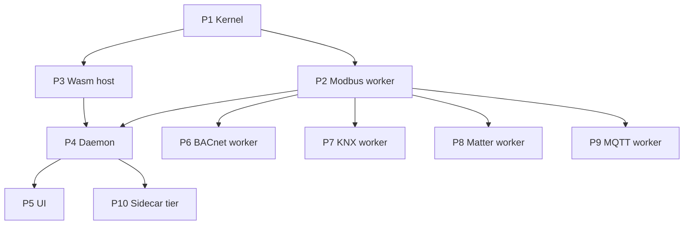

<!--
SPDX-FileCopyrightText: 2026 Lusoris <lusoris@pm.me>

SPDX-License-Identifier: EUPL-1.2
-->
# Rhizomorph phase plan

The plan is a graph. Each node is a phase with a deliverable and an exit
check. A phase is done when its exit check passes; a check that names a
test names the test that phase writes. No engine code exists yet, so every
command and test name below is planned, not run. The plan restates a design
input by the operator; versions come from [`../concept.md`](../concept.md).

Each test list uses three kinds: **positive** (it works as intended),
**negative** (bad input or failure is refused or contained) and **boundary**
(the edge of a limit).

## Phases

| Id | Title | Depends on | Deliverable | Exit check |
| :--- | :--- | :--- | :--- | :--- |
| P1 | Kernel | none | `no_std` core crate and a `std` adapter: point arena, priority array, leases, deadband, COV, dependency licence check in CI | `cargo test -p kernel` (includes the size assertion and the equality and deadband tests) |
| P2 | Modbus worker | P1 | Fieldbus worker on `tokio-modbus`, TOML device profiles, point registration, supervisor restart | `cargo test -p bus-modbus` |
| P3 | Wasm host | P1 | Wasmtime host, WIT contract, limits, lease revoke on failure | `cargo test -p host-wasm` |
| P4 | Daemon | P1, P2, P3 | Daemon: redb state, fjall telemetry pipeline, boot restore, daemon API; storage benchmark gate | `cargo test -p daemon` and the benchmark gate recorded in [ADR-0004](../adr/0004-storage-split.md) |
| P5 | UI | P4 | SvelteKit UI on `golusoris/sveltesentio` against the daemon API | daemon API contract test `cargo test -p daemon api_contract`, plus the UI test script named when the UI is scaffolded |
| P6 | BACnet worker | P2 | BACnet worker; decide git dependency or crates.io for `rusty-bacnet` | named in this phase when it starts |
| P7 | KNX worker | P2 | KNX worker on `aimdb-knx-connector` | named in this phase when it starts |
| P8 | Matter worker | P2 | Matter worker on `rs-matter` | named in this phase when it starts |
| P9 | MQTT worker | P2 | MQTT worker on `rumqttc` | named in this phase when it starts |
| P10 | Sidecar tier | P4 | Unix-domain-socket sidecar protocol | named in this phase when it starts |

The commands follow the workspace sketch: crates `kernel`, `host-wasm`,
`bus-modbus` and `daemon`, Rust edition 2024. The workspace
toolchain is chosen in P1; MSRV values range from 1.76 to 1.98.0
([`../concept.md`](../concept.md#gain-and-cost)). P6 to P10 are later nodes
and are not detailed.

Mermaid view of the same nodes:

## P1: Kernel

Decisions: [ADR-0002](../adr/0002-priority-array-and-leases.md). Defects
fixed: 1, 2, 3, 4, 5, 6, 7 ([`design-defects.md`](design-defects.md)).

- **Positive**: lowest level number wins; relinquishing the winning slot
  falls back to the next slot; a deadband update inside the threshold fires
  no COV event and one outside it does; revoke of a lease clears every slot
  it holds and fires COV for each value that changed; the last relinquish
  sets the relinquish default and fires COV.
- **Negative**: NaN and infinities refused at ingress; `Priority` 0 and 17
  refused; level 6 refused for plugin and schedule writers; a lease cannot
  clear another lease's slot; negative or non-finite deadband refused at
  registration; an `i64` and an `f64` of equal magnitude are not equal.
- **Boundary**: `Priority` 1 and 16 accepted; lease ids 63, 64 and 65 do not
  collide; deadband 0.0; the size assertion `PriorityArray` = 384 bytes on
  x86_64 (not promised on 32-bit targets); revoke of a lease that holds one
  point among many visits only that point.
- The licence check for dependencies ([ADR-0005](../adr/0005-licence.md)) runs
  in CI.

## P2: Modbus worker

Decisions: [ADR-0001](../adr/0001-tier-model.md). The test mechanism for a
Modbus peer is chosen in this phase and is not verified yet.

- **Positive**: a profile registers its points with deadband and
  writability; a read changes the present value of an input.
- **Negative**: a malformed profile is refused at start; a worker panic
  restarts the task, revokes its lease and leaves kernel state intact; every
  socket call has an explicit deadline (HISS-02).
- **Boundary**: first and last register of a map; a deadband equal to the
  reading difference; a restart repeated up to the supervisor's bound.

## P3: Wasm host

Decisions: [ADR-0003](../adr/0003-wit-contract-push-model.md). Defect fixed: 8
(kept on purpose).

- **Positive**: `init` returns point ids and `on-cov` receives pushed events
  for them only; `command-point` sets a slot under the host-held lease.
- **Negative**: a trap, a memory overrun and a missed epoch deadline each
  revoke the lease and fire COV; a guest blocked in a host call is ended by
  the host timeout; a guest cannot express level 1 or 6.
- **Boundary**: memory grown to exactly the `StoreLimits` cap and one step
  past it; the deadline at the tick before and after expiry; a replay test
  using fuel for a deterministic trap; queue at its bound.

## P4: Daemon

Decisions: [ADR-0004](../adr/0004-storage-split.md). The daemon API protocol
is decided in this phase.

- **Positive**: point definitions, mappings and relinquish defaults are
  written to redb and rebuild an identical arena at boot; COV events reach
  fjall.
- **Negative**: a corrupt or missing state file is refused with a stated
  error; a slow or failed telemetry pipeline does not block the kernel; an
  unauthenticated API call is refused.
- **Boundary**: an empty database; the largest point count the benchmark
  uses.
- **Gate**: the storage benchmark runs on target hardware, with the shapes
  of the redb README benchmark (individual writes, batched writes,
  unsynced writes, `len()`, bulk load). Its result is written into
  [ADR-0004](../adr/0004-storage-split.md) before that record leaves Proposed.

## P5: UI

Decisions: [ADR-0006](../adr/0006-ui-stack.md).

- **Positive**: the UI shows present values and sends a command through the
  daemon API; closing the session releases its commands.
- **Negative**: the UI reaches the daemon only through its API (a check that the UI
  package has no path to the kernel); an API error shows a
  stated message instead of stale values.
- **Boundary**: a session at the lowest and highest priority the daemon
  grants it; an empty point list.
