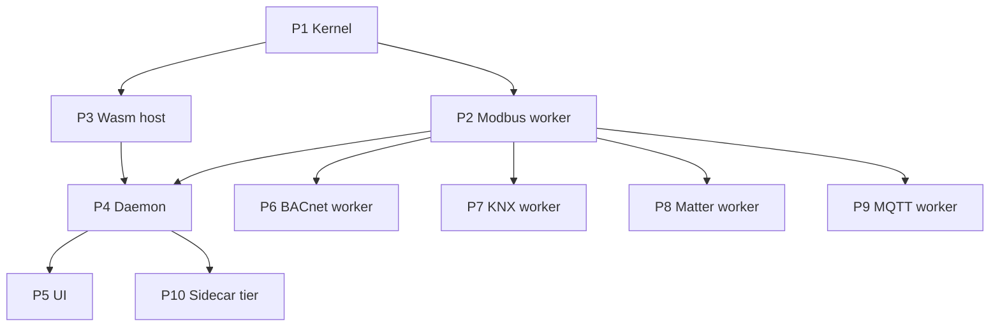

<!--
SPDX-FileCopyrightText: 2026 Lusoris <lusoris@pm.me>

SPDX-License-Identifier: EUPL-1.2
-->
# Rhizomorph phase plan

The plan is a graph. Each node is a phase with a deliverable and an exit
check. A phase is done when its exit check passes; a check that names a
test names the test that phase writes. No engine code exists yet, so every
command and test name below is planned, not run. The plan restates a design
input by the operator; versions come from [`../concept.md`](../concept.md).

Each test list uses three kinds: **positive** (it works as intended),
**negative** (bad input or failure is refused or contained) and **boundary**
(the edge of a limit).

## Phases

| Id | Title | Depends on | Deliverable | Exit check |
| :--- | :--- | :--- | :--- | :--- |
| P1 | Kernel | none | `no_std` core crate and a `std` adapter: point arena, priority array, leases, deadband, COV, dependency licence check in CI | The five checks listed under [P1: Kernel](#p1-kernel) |
| P2 | Modbus worker | P1 | Fieldbus worker on `tokio-modbus`, TOML device profiles, point registration, supervisor restart | `cargo test -p bus-modbus` |
| P3 | Wasm host | P1 | Wasmtime host, WIT contract, limits, lease revoke on failure | `cargo test -p host-wasm` |
| P4 | Daemon | P1, P2, P3 | Daemon: redb state, fjall telemetry pipeline, boot restore, daemon API; storage benchmark gate | `cargo test -p daemon` and the benchmark gate recorded in [ADR-0004](../adr/0004-storage-split.md) |
| P5 | UI | P4 | SvelteKit UI on `golusoris/sveltesentio` against the daemon API | daemon API contract test `cargo test -p daemon api_contract`, plus the UI test script named when the UI is scaffolded |
| P6 | BACnet worker | P2 | BACnet worker; decide git dependency or crates.io for `rusty-bacnet` | named in this phase when it starts |
| P7 | KNX worker | P2 | KNX worker on `aimdb-knx-connector` | named in this phase when it starts |
| P8 | Matter worker | P2 | Matter worker on `rs-matter` | named in this phase when it starts |
| P9 | MQTT worker | P2 | MQTT worker on `rumqttc` | named in this phase when it starts |
| P10 | Sidecar tier | P4 | Unix-domain-socket sidecar protocol | named in this phase when it starts |

The commands follow the workspace sketch: crates `kernel`, `host-wasm`,
`bus-modbus` and `daemon`, Rust edition 2024; P1 adds the `std` adapter
crate and names it. The workspace toolchain is chosen in P1; MSRV values
range from 1.64.0 to 1.98.0 ([`../concept.md`](../concept.md#gain-and-cost)).
P6 to P10 are later nodes and are not detailed.

Mermaid view of the same nodes:

## P1: Kernel

Decisions: [ADR-0001](../adr/0001-tier-model.md) (core and adapter split),
[ADR-0002](../adr/0002-priority-array-and-leases.md),
[ADR-0005](../adr/0005-licence.md) (licence check). Defects fixed: 1, 2, 3,
4, 5, 6, 7 ([`design-defects.md`](design-defects.md)).

Exit check, all five pass:

1. `cargo test --workspace`: the kernel and its `std` adapter, including the
   size assertion and the equality, deadband and lease tests below.
2. `cargo build -p kernel --target thumbv7em-none-eabihf`: a target without
   `std`, so the build proves the core is `no_std` (defect 1).
3. `cargo clippy --workspace --all-targets -- -D warnings -D clippy::unwrap_used -D clippy::expect_used`,
   with `allow-unwrap-in-tests` and `allow-expect-in-tests` in `clippy.toml`
   (HISS-07, HISS-10, defect 2).
4. `cargo deny check licenses` in CI ([ADR-0005](../adr/0005-licence.md)),
   with an allow-list of the licence families in ADR-0005; a planted
   dependency under a licence outside the list fails the check.
5. The defect 4 measurement: the cost of the ingress lock and of the clock
   read, before and after the fix, recorded in the P1 pull request.

Tests:

- **Positive**: lowest level number wins; relinquishing the winning slot
  falls back to the next slot; a deadband update below the threshold changes
  the present value and fires no COV event, and one at or above it fires
  COV; the first update of a point fires; revoke of a lease clears every
  slot it holds and fires COV for each value that changed; the last
  relinquish sets the relinquish default and fires COV; a write to a slot
  that does not win fires no COV; the core takes time only as a value passed
  in by the adapter.
- **Negative**: NaN and infinities refused at ingress; `Priority` 0 and 17
  refused; level 6 refused for every external writer; a lease cannot clear
  another lease's slot; a write or relinquish under a revoked lease refused;
  revoking a lease twice, or an id never issued, changes nothing; negative or
  non-finite deadband refused at registration; an `i64` and an `f64` of
  equal magnitude are not equal; a registration or lease request past its
  capacity refused; a command to an input, telemetry for an output, a value
  of the wrong kind and an unknown point id refused; a poisoned lock in the
  adapter returns an error with context instead of a panic.
- **Boundary**: `Priority` 1 and 16 accepted; lease ids 63, 64 and 65 do not
  collide; deadband 0.0; a difference exactly equal to the threshold fires;
  `-0.0` after `0.0` fires nothing; an `i64` update from `i64::MIN` to
  `i64::MAX`; the arena, lease table and per-lease index each at capacity;
  the size assertion `PriorityArray` = 384 bytes on x86_64 (not promised on
  32-bit targets); revoke of a lease that holds one point among many visits
  only that point; a command to a new point when the lease's index is at
  capacity is refused and leaves every slot unchanged; a lease id is not
  reused while the kernel runs, and a lease request after the last id is
  refused instead of wrapping.
- A write to a slot that another lease holds, and a writer that hangs
  without failing: P1 decides both
  ([ADR-0002](../adr/0002-priority-array-and-leases.md#leases)) and tests
  each decision.

## P2: Modbus worker

Decisions: [ADR-0001](../adr/0001-tier-model.md). The test mechanism for a
Modbus peer is chosen in this phase and is not verified yet.

- **Positive**: a profile registers its points with deadband and
  writability; a read changes the present value of an input.
- **Negative**: a malformed profile is refused at start; a worker panic
  restarts the task, revokes its lease and leaves kernel state intact; every
  socket call has an explicit deadline (HISS-02).
- **Boundary**: first and last register of a map; a deadband equal to the
  reading difference; a restart repeated up to the supervisor's bound.

## P3: Wasm host

Decisions: [ADR-0003](../adr/0003-wit-contract-push-model.md). Defect fixed: 8
(kept on purpose).

- **Positive**: `init` returns point ids and `on-cov` receives pushed events
  for them only; `command-point` sets a slot under the host-held lease; a
  guest without a declared cap commands levels 9 and 16; a guest whose
  manifest requests level 2 and whose digest has a host record for level 2
  loads and commands at 2; the same for level 5.
- **Negative**: a trap, a memory overrun and a missed epoch deadline each
  revoke the lease and fire COV; a guest blocked in a host call is ended by
  the host timeout; a host call still blocked when the absolute guest deadline
  expires ends by that deadline; a guest cannot express level 1 or 6; a
  subscription, report or command for a point the manifest does not list is
  refused; a module with more memories or instances than the store caps fails
  to instantiate; without a record, a command at level 2 or 5 is refused; a
  record for 2 does not open 5; a command at 3, 4, 7 or 8 is refused for
  every guest; a manifest with a cap of 8 or a request for level 1, 3 or 6
  fails to load; a manifest that requests level 2 or 5 without a host record
  for its digest fails to load; a host record for one digest of a plugin
  does not load another digest of the same plugin; a guest holds a level 5
  slot and its record is revoked: the slot is relinquished and COV fires, the
  next command at 5 is refused, and its slots at 9 to 16 are unchanged; a
  command checked before a concurrent revoke of its record leaves no slot at
  the revoked level.
- **Boundary**: memory grown to exactly the `StoreLimits` cap, and one step
  past it traps and revokes the lease; the deadline at the tick before and
  after expiry, including a guest that returns from a slow host call; a
  replay test using fuel for a deterministic trap; queue at its bound; a cap
  of 9 accepts level 9 and refuses 8; a cap of 16 accepts 16 and refuses 15;
  caps of 0 and 17 fail to load; a guest that calls a fast host function in
  a loop is stopped at the absolute deadline; a manifest that requests
  levels 2 and 5 with a host record for level 2 only fails to load; a host
  timeout longer than the time left to the deadline ends at the deadline.

## P4: Daemon

Decisions: [ADR-0004](../adr/0004-storage-split.md). The daemon API protocol
is decided in this phase.

- **Positive**: point definitions, mappings and relinquish defaults are
  written to redb and rebuild the same points at boot, with every slot empty
  and each output at its relinquish default; COV events reach fjall.
- **Negative**: a corrupt or missing state file is refused with a stated
  error; a slow or failed telemetry pipeline does not block the kernel; an
  unauthenticated API call is refused; every storage and API call has an
  explicit deadline, and one past it returns an error (HISS-02).
- **Boundary**: an empty database; the largest point count the benchmark
  uses; the telemetry channel at its bound, with the lag behaviour decided
  in this phase.
- **Gate**: the storage benchmark runs on target hardware, with the shapes
  of the redb README benchmark (individual writes, batched writes,
  unsynced writes, `len()`, bulk load), plus the telemetry shapes: a COV
  append stream at the rate the largest point count produces, a time-range
  scan of the kind the UI history needs, a retention delete with its
  compaction, the recovery time after a forced crash and the number of
  telemetry events lost in it. Its result is written into
  [ADR-0004](../adr/0004-storage-split.md) before that record leaves Proposed.

## P5: UI

Decisions: [ADR-0006](../adr/0006-ui-stack.md).

- **Positive**: the UI shows present values and sends a command through the
  daemon API; closing the session releases its commands.
- **Negative**: the UI reaches the daemon only through its API (a check that the UI
  package has no path to the kernel); an API error shows a
  stated message instead of stale values.
- **Boundary**: a session at the lowest and highest priority the daemon
  grants it; an empty point list.
